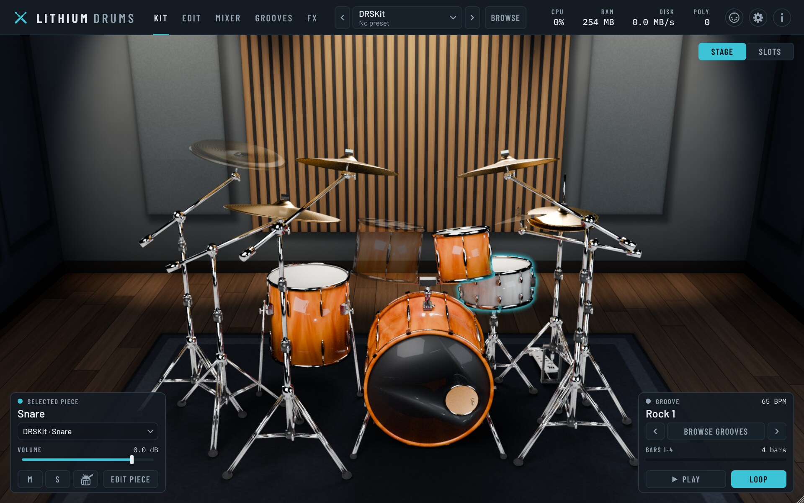
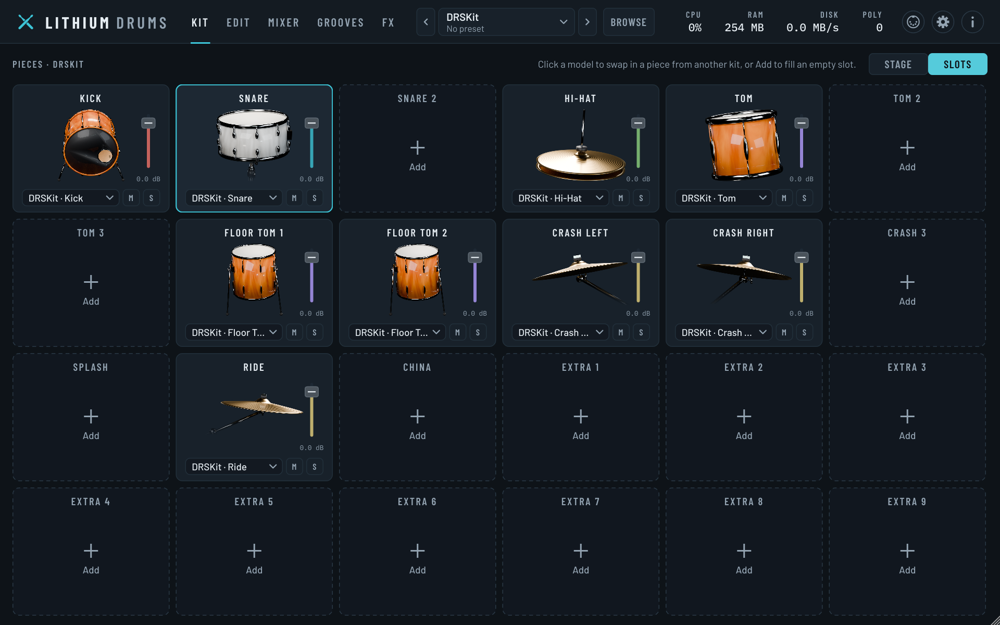
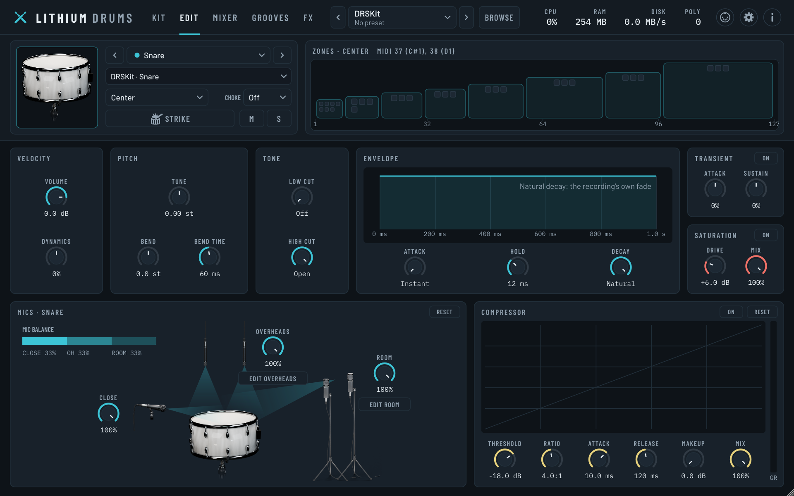
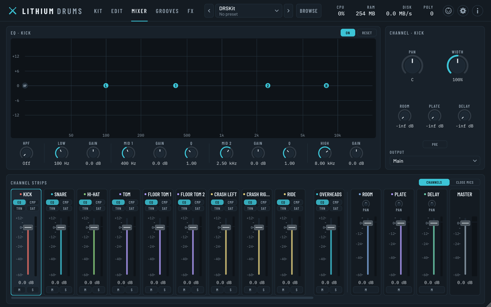
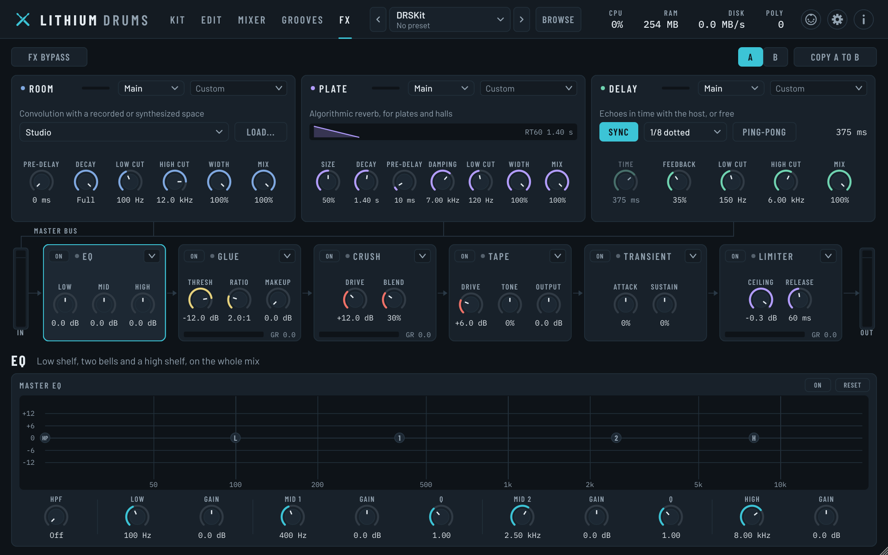
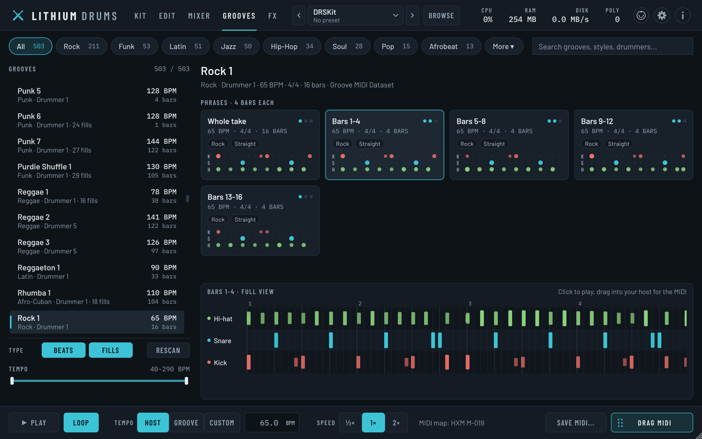
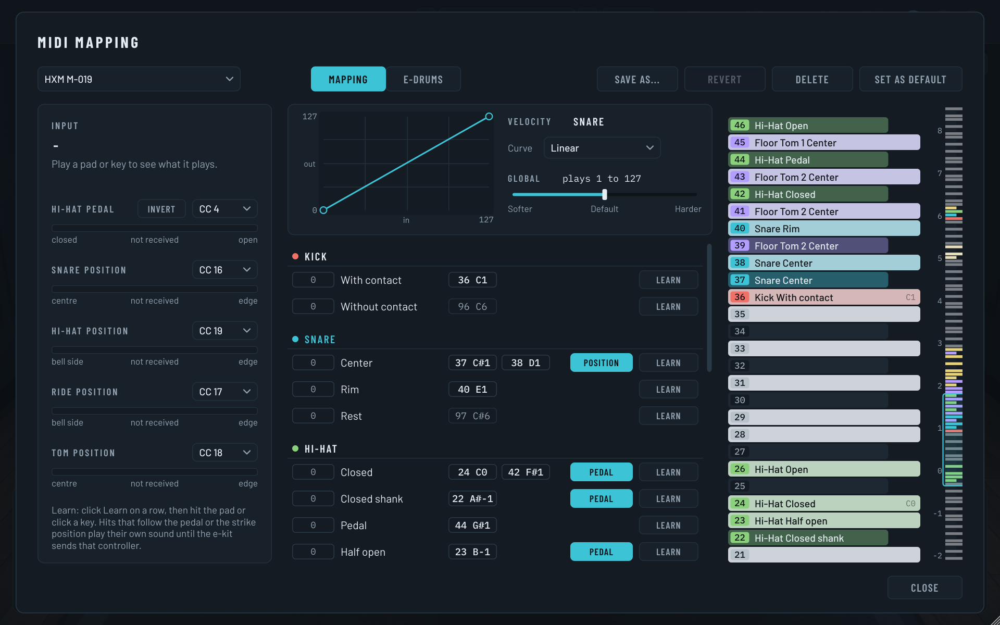
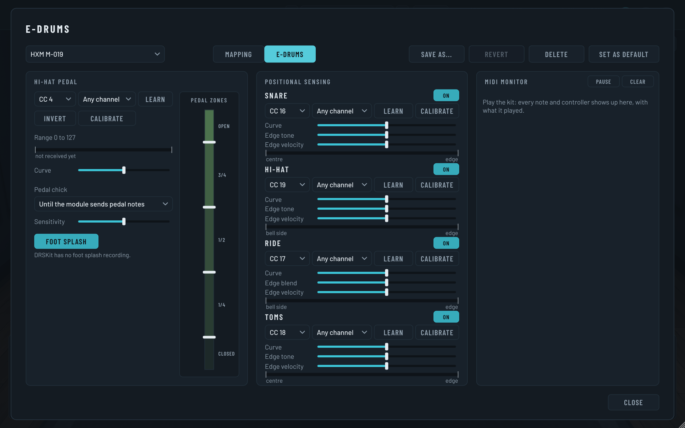
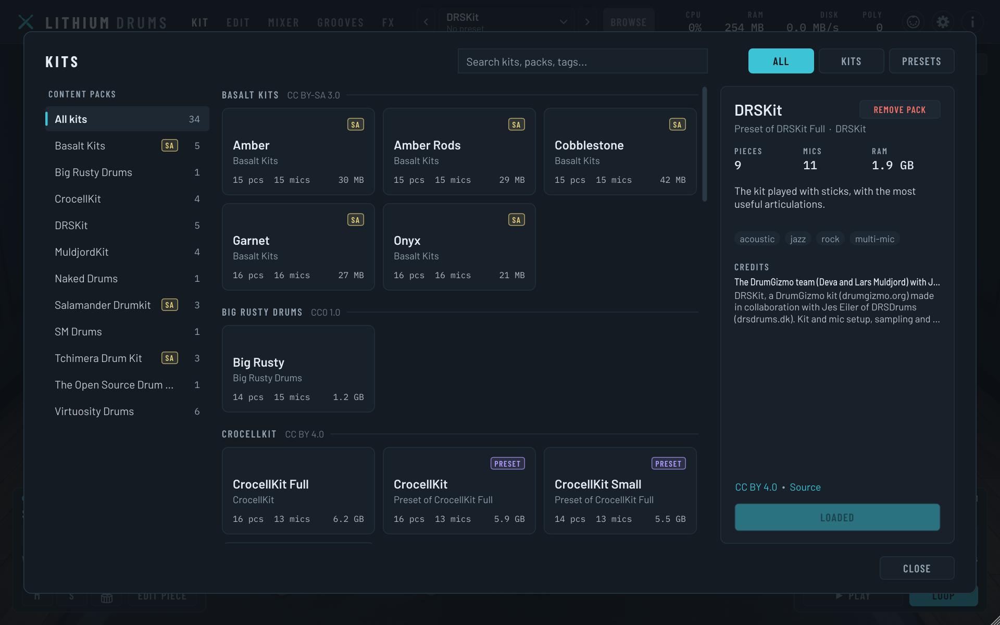

# Lithium Drums

**A free, open-source acoustic drum sampler.** Real multi-mic recordings of real kits, a mixer and effects to shape them, and 1,150 grooves played by human drummers, in your DAW or on its own.



VST3, CLAP, AU and a standalone app · Linux, Windows and macOS · Version 0.9.3 · Free software, [GNU AGPLv3](LICENSE)

By Isaac Joseph ([Calamity Audio](https://github.com/thecalamityjoe87)).

## What it is

Lithium Drums plays sampled acoustic drums the way a real kit is recorded: every hit was captured by close mics on each drum plus overheads and room mics, at many velocities and with several takes of each, so no two hits sound quite the same. You decide how much of each mic you hear, shape each drum, and mix the result like a studio session.

The sounds come from eleven free drum libraries recorded by other people, sixteen kits in all, from a hand-made vintage Polish kit to metal kits recorded with seventeen mics. Lithium Drums downloads and converts them for you, so there's nothing to unzip or import. Large kits stream from disk: DRSKit takes about 360 MB of RAM instead of 3 GB.

It's early software. Everything below works, but expect rough edges, and expect things to change before 1.0.

## What it can do

### Play a kit

The Kit page shows the loaded kit on a stage. Click any drum or cymbal to hear it and select it, then set its level or jump to its settings from the card in the corner. The groove card in the other corner plays a groove through the kit without leaving the page. Sixteen kits come from the libraries, plus eighteen kit presets that reuse their recordings with other pieces, tunings or mics, and sound presets grouped by style (Rock, Jazz, Funk, Metal, Vintage, Lo-Fi and more).

### Build your own kit



Switch the Kit page to Slots and every kit becomes the same grid of 24 slots. Swap any piece for the same kind of piece from any kit you have installed (a different snare, a bigger floor tom, another ride), fill the empty slots with extra toms, cymbals or percussion, and save the result as a preset. "Ambience follows piece" brings the swapped piece's own overhead and room sound along with it.

### Shape every drum



The Edit page works on one drum at a time: how it responds to velocity, its tuning and a pitch bend on each hit, a tone filter, its attack, hold and decay, and a transient shaper, saturation and compressor. Its mics are drawn around a picture of the drum, so you set how much the close mic, overheads and room each hear it. A kit recorded without overheads or a room mic can have them emulated from its other mics.

### Mix it



Every drum gets its own channel, plus the overhead and room mics, three effect returns and the master. Selecting a channel shows its EQ over a live spectrum of the channel, its pan, stereo width and sends. In a DAW, sixteen stereo aux outputs let you send any channel to its own track.

### Add effects



Three effect returns every channel can send to: Room, a convolution reverb with five spaces (a studio, a measured seminar room, a tiled room, a hall and a plate); Plate, an algorithmic reverb; and a Delay that syncs to your project's tempo. The master bus has an EQ, glue and crush compressors, tape saturation, a transient shaper and a limiter.

### Play grooves



The Grooves page has 1,150 recorded performances by real drummers in styles from rock and funk to Latin, jazz and Afro-Cuban, cut into phrases and fills. Click a tile to hear it on the loaded kit, in time with your project, then drag it onto a track to get its MIDI.

### Play it from an e-kit or a keyboard



Every kit plays from the same MIDI map, so switching kits never changes what your notes play. The MIDI panel shows what every note plays, lets you learn any articulation from a pad or key, and has velocity curves for the whole kit, each drum and each hit. Maps for Roland V-Drums and Alesis kits are built in.



For electronic kits, the hi-hat follows the pedal continuously, with chicks and foot splashes, and snare, ride and tom hits follow positional sensing. The E-Drums view calibrates the pedal and pads, with a monitor of the MIDI coming in.

### Find and download kits



The kit browser shows every kit and kit preset, searchable by name, style or tag, with each one's credits. Libraries you haven't downloaded yet are there too, greyed out, with a Download button.

## Install

Download the installer for your system from the [Releases](../../releases) page:

- **Linux:** unpack the `.tar.gz` and double-click "Install Lithium Drums". It installs into your home folder (no password) and adds Lithium Drums to your app menu. Run it again to update or remove it.
- **Windows:** run `LithiumDrums-<version>-windows-setup.exe`.
- **macOS:** open `LithiumDrums-<version>-macos.pkg`.

Each installer lets you pick the standalone app and the plugin formats. The installers aren't signed yet, so Windows may show a SmartScreen warning ("More info", then "Run anyway") and macOS may refuse to open it as coming from an unidentified developer (allow it under System Settings › Privacy & Security, Open Anyway).

Then open Lithium Drums (in your DAW, rescan plugins and add it to an instrument track), press **Browse** in the header and download a kit. For rock, start with CrocellKit or Naked Drums.

## The kits

The kits and grooves aren't in this repository; they're free libraries by other people, and Lithium Drums downloads them for you. Open the kit browser (Browse, in the header): every library that isn't installed yet is there, greyed out, with a Download button. It fetches the library from its authors' site, converts it and deletes the download again, so there's nothing to unzip or keep around. The Grooves tab does the same for the grooves. From a terminal, `LithiumImport --list-packs` lists them and `LithiumImport --install <id>` (or `all`) installs one. How it works is in [docs/packs.md](docs/packs.md).

| Library | Download | Licence |
|---|---|---|
| DRSKit 2.1 (DrumGizmo) | 2.8 GB | CC BY 4.0 |
| MuldjordKit 3 (DrumGizmo) | 2.5 GB | CC BY 4.0 |
| CrocellKit 1.1 (DrumGizmo), metal and rock | 5.6 GB | CC BY 4.0 |
| Naked Drums (Wilkinson Audio), metal and hard rock | 2.5 GB | CC BY 4.0 |
| Virtuosity Drums 0.925 | 1.2 GB | CC0 |
| Big Rusty Drums 1.100 (Karoryfer) | 620 MB | CC0 |
| SM Drums 1.2 | 2.4 GB | free to use in your productions; no licence text |
| The Open Source Drum Kit (Real Music Media), with a gong | 530 MB | public domain |
| AVL Drumkits, as the Basalt Kits | 90 MB | CC BY-SA 3.0 |
| Salamander Drumkit | 360 MB | CC BY-SA 3.0 |
| Tchimera Drum Kit (Tchackpoum's Ludwig Black Cortex recordings), made for e-kits | 800 MB | CC BY-SA 4.0 (music made with it: CC0) |
| Groove MIDI Dataset (Google Magenta) | 3 MB | CC BY 4.0 |

Kits go into your kits folder: `~/.local/share/Lithium Drums/Kits` on Linux, `~/Library/Application Support/Lithium Drums/Kits` on macOS, `%LOCALAPPDATA%\Lithium Drums\Kits` on Windows. You can change it in the plugin's settings (the gear in the top right). Grooves go into a Grooves folder next to it.

If you've downloaded a library yourself, `LithiumImport <folder>` converts it from the unpacked folder (for CrocellKit, the `CrocellKit` folder inside the zip; for The Open Source Drum Kit, the `the-open-source-drumkit-master` folder). On the same drive, the audio is hard-linked rather than copied, so the kits take no extra space, and deleting the download afterwards is fine.

The kits' authors ask to be credited when you publish music made with them; the About dialog (the "i" button) shows the credits of every installed pack. SM Drums has no licence beyond its author's "use it in your productions", so don't pass that converted kit on. The Basalt Kits (from the AVL Drumkits), the Salamander kits and the Tchimera Drum Kit are share-alike: music you make with them is yours to license, but the converted kits themselves may only be passed on under the same licence, which is why each library is kept in a pack of its own.

## Using it

The box in the middle of the header is the preset menu: your presets, the factory presets, and under "Start from a kit" every installed kit. The arrows either side step through them, and an asterisk shows when the sound has changed since it was saved. Save your own with Save as...; presets go in a `Presets` folder next to the kits folder, one `.lithiumpreset` file each.

Every kit plays from the same MIDI map, Lithium Standard: General MIDI plus a fixed note for every other kind of hit. Cymbals are choked by notes 85-92, also the same on every kit. The MIDI panel (the MIDI button in the header, which flashes as notes arrive) also offers each library's own map, General MIDI and the e-kit maps. Learn remaps any articulation; Save as keeps the map for other projects, and Set as default starts every new instance with it. E-kit settings belong to the MIDI map, not to presets, so loading a preset never changes your hardware setup.

On the Grooves page, pick a style and a groove, then click any phrase or fill tile to hear it. With the tempo on Host it follows your project's tempo and stays in step while the project plays. Drag a tile (or the Drag MIDI handle) onto a track to get its MIDI, written in the notes of whichever MIDI map you use.

For mixing in a DAW, enable the plugin's sixteen stereo aux outs in the host, then pick an output for each channel in the Mixer; several can share one, such as all the toms on Aux 4. The plugin adds no latency unless you switch on the limiter's lookahead on the FX page, which adds 2 ms and tells the host.

Kits over 512 MB stream from disk. The first time one streams, its audio is decoded into a stream cache (`~/.cache/Lithium Drums/Stream Cache` on Linux, `~/Library/Caches/...` on macOS, `%LOCALAPPDATA%\Lithium Drums\Stream Cache` on Windows), which takes a few seconds and about as much disk space as the kit takes in RAM. The header says "Caching" while that happens; after that the kit loads in a fraction of a second. Settings (the gear in the header) has the streaming mode, the preload size, a button to clear the cache, and the kits folder. Muting a mic for a couple of seconds unloads it from memory.

## Licence and credits

Lithium Drums is Copyright (C) 2026 Isaac Joseph. It is free software: you can redistribute it and change it under the terms of the GNU Affero General Public License, version 3, in [LICENSE](LICENSE). It comes with no warranty.

The packages also carry `THIRD-PARTY-NOTICES.txt`, the copyright notices and licences of the code built into the program (JUCE and the libraries it includes, the VST3 SDK, CLAP, the LZMA SDK) and of the fonts. `scripts/third-party-notices.py` writes it from the licence files of the downloaded dependencies, so it follows their versions.

The grooves are the Groove MIDI Dataset's drummers', under CC BY 4.0; the About dialog credits them. The Room reverb's Seminar Room IR is from the HOMULA-RIR dataset (Politecnico di Milano, CC BY 4.0); its other IRs are synthesized by `tools/irgen` and are CC0. The fonts (Barlow, Barlow Condensed, IBM Plex Mono) are under the SIL Open Font License; see `assets/fonts/`. JUCE is dual-licensed under the AGPLv3 and a commercial licence. The kits are their authors', under the licences in the table above.

## Development

How it works inside is described in the docs: the kit format, kit presets, piece swapping, content packs and the importers in [docs/kit-format.md](docs/kit-format.md), streaming in [docs/streaming.md](docs/streaming.md), shaping and mixing in [docs/mixer.md](docs/mixer.md), the effects in [docs/fx.md](docs/fx.md), MIDI maps and e-kits in [docs/midi.md](docs/midi.md), grooves in [docs/grooves.md](docs/grooves.md), and the pack downloads in [docs/packs.md](docs/packs.md).

### Building

You need CMake 3.25+, Ninja and a C++20 compiler. JUCE, the CLAP extensions and the LZMA SDK (for unpacking 7z downloads) are downloaded by CMake on the first configure.

On Linux, install JUCE's dependencies first (Debian/Ubuntu package names):

```
sudo apt install build-essential cmake ninja-build libasound2-dev libjack-jackd2-dev \
    libfreetype-dev libfontconfig1-dev libx11-dev libxcomposite-dev libxcursor-dev \
    libxext-dev libxinerama-dev libxrandr-dev libxrender-dev libxi-dev libgl-dev libcurl4-openssl-dev
```

Then:

```
scripts/build.sh release      # or: debug
```

The script just runs `cmake --preset <name>` and `cmake --build --preset <name>`. Output lands in `build/<preset>/`. The build runs one compile per 2.5 GB of RAM, since JUCE's sources take a lot of memory to compile and a compile per core can run a machine out of it. On Windows, run the same presets from a Visual Studio developer prompt. On macOS, install Ninja with Homebrew.

To try a build, run the standalone app from `build/release/LithiumDrums_artefacts/Release/Standalone/`. To use the plugin in a DAW, point the DAW at the build folder, or copy (or symlink) `VST3/Lithium Drums.vst3` into `~/.vst3` and `CLAP/Lithium Drums.clap` into `~/.clap`. Configuring with `-DLITHIUM_COPY_PLUGINS=ON` makes the build copy them for you.

### Packaging and installers

Each system gets a graphical installer that shows the two ways to use Lithium Drums (as a plugin in a DAW, or as a standalone app) and lets the user pick the standalone app, VST3, CLAP (and AU on macOS):

| System | Installer | Built by | Installs to |
|---|---|---|---|
| Linux | `LithiumDrums-<version>-linux-x86_64.tar.gz`: unpack, double-click "Install Lithium Drums" (its own window, `tools/installer/`) | `scripts/package.sh` | the home folder, no password: `~/.vst3`, `~/.clap`, `~/.local/share/lithium-drums` plus an app-menu entry |
| Windows | `LithiumDrums-<version>-windows-setup.exe` (Inno Setup, `packaging/windows/LithiumDrums.iss`) | `scripts/package.ps1` (needs Inno Setup 6 or 7) | `Program Files`, `Common Files\VST3`, `Common Files\CLAP` |
| macOS | `LithiumDrums-<version>-macos.pkg` (the Installer app, `packaging/macos/`) | `scripts/package.sh` | `/Applications`, `/Library/Audio/Plug-Ins/{VST3,CLAP,Components}` |

Running the Linux installer again offers Update and Remove; Remove deletes only what it installed (it keeps a list in `~/.local/share/lithium-drums/install.json`), never kits, presets or settings. It also runs from a terminal: `./"Install Lithium Drums" --install` (or `--remove`).

`.github/workflows/release.yml` builds all three on GitHub's machines: run it from the Actions tab, or push a version tag (`v0.9.3`) to get a draft release with the installers attached. Unsigned, Windows shows a SmartScreen warning and macOS an "unidentified developer" one; the workflow's comments list the secrets that turn on macOS signing and notarization (an Apple Developer account).

The icon and the installers' artwork (`assets/icon/`) are drawn from the same code as the header's logo (`src/ui/Logo.cpp`); after changing it, run `scripts/make-icons.sh` (needs ImageMagick).

### Tests

```
build/release/LithiumDrumsTests                    # engine, loader, streaming, presets, the importers, processor and UI hit-testing
build/release/LithiumHostSmokeTest_artefacts/Release/LithiumHostSmokeTest   # loads the VST3 like a host
build/release/LithiumDrumsTests --measure-kit "<kit folder>"   # plays a real kit and reports its memory use
build/release/LithiumDrumsTests --measure-kit "<kit folder>" --stream --stress 30 --cold   # streams it, under load, from a cold cache
build/release/LithiumDrumsTests --measure-kit "<kit folder>" --stress 30 --full-mix       # with every effect and all the shaping switched on
build/release/LithiumDrumsTests --measure-kit "<kit folder>" --map roland-vdrums           # through the Roland map, sweeping the hi-hat pedal and snare position
build/release/LithiumDrumsTests --midi-audit                                               # every installed kit against every MIDI map, and every articulation played once
build/release/LithiumDrumsTests --swap-audit                                               # every installed kit's pieces swapped into every other kit, then a few played
build/release/LithiumDrumsTests --fx-cost                                                  # what each effect costs, as a share of a core
build/release/LithiumDrumsTests --emulation-compare "<kit folder>" [--out <folder>]        # emulated overheads and room against a kit's real ones
```

The tests use a small synthesized kit that the build generates, so they don't need the real kits.

### Re-rendering the kit images

`assets/blender-kit.py` built the renders in `assets/kit-renders/`: the stage's layers, and each piece on its own for the Kit tab's slot cards. To render the kit in another finish (the `finish` argument is the shell colour in linear RGB), run it with Blender in both modes, then crop the results into place:

```
blender -b -P assets/blender-kit.py -- mode=layers scale=0.75 samples=128 finish=0.05,0.1,0.3
blender -b -P assets/blender-kit.py -- mode=pieces scale=2.25 samples=128 finish=0.05,0.1,0.3
python3 assets/crop-layers.py
```

Each kit's drums also come in its own finish (`assets/kit-finishes.json`), so a kit with swapped-in pieces shows each piece in the finish of the kit it came from. To render one, add `kit=<kit id> only=kick,tom1,tom2,floor,snare out=<folder>` to both Blender commands, then run `python3 assets/crop-layers.py --finish <kit id> <folder>`. Kits not listed keep the default red. To redo just one drum, add `border=auto`: Blender renders only the part of the frame that drum covers, which is much faster, and the crop is the same.

Scale 0.75 gives the 1.5× renders the UI expects. The build never runs Blender. Some distro Blender packages are built without OpenImageDenoise, so the renders come out grainy; use `samples=512` there instead.

The studio room behind the kit doesn't need Blender. `tools/roomgen/RoomGenerator.cpp` paints it through the same camera, so if you move the camera in the Blender script, move it there too. To repaint it (`--preview` also composites the kit over it, for checking):

```
build/release/LithiumRoomGen_artefacts/Release/LithiumRoomGen assets/kit-renders --preview room-preview.jpg
```
